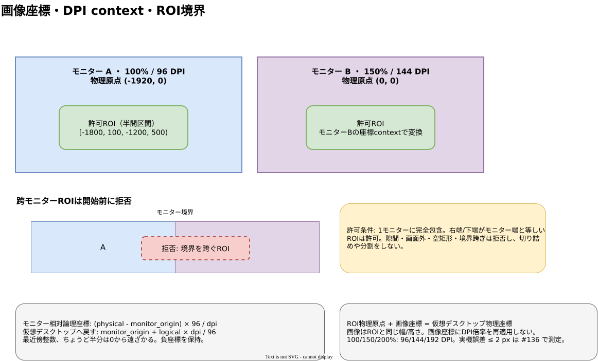

# 画像座標契約

## 文書情報

- 対象: v1.0 画像取得・OCR結果の座標
- 状態: 採用
- Issue: [#63](https://github.com/kwdch013/screen_traslation/issues/63)
- 根拠: [基本・詳細設計](../docs/v1.0/design/architecture.md)、[混在DPI調査](../docs/v1.0/research/mixed-dpi.md)、REQ-F-002 / REQ-F-005 / REQ-NF-008、ACC-06 / ACC-07
- 言語非依存の算例: [coordinate-cases.json](fixtures/geometry/coordinate-cases.json)

## 座標系と矩形

すべての矩形は物理ピクセルで表す `[left, top, right, bottom)` の半開区間とする。左上端を含み、右端・下端を含まない。幅は `right - left`、高さは `bottom - top`。座標の原点は仮想デスクトップの原点であり、左または上のモニターは負座標を持ち得る。符号を保持し、主モニター外の座標を0以上へ補正しない。

| 座標 | 原点・単位 | 用途 |
|---|---|---|
| 仮想デスクトップ物理座標 | 仮想スクリーン原点、physical px | モニター矩形、選択ROI、重畳の配置 |
| モニター相対論理座標 | 対象モニター物理矩形の左上、96 DPI基準px | DPI対応UI/APIとの変換境界 |
| 画像座標 | 取得ROI画像の左上 `(0, 0)`、physical px | OCR領域・画像内位置 |

取得画像はROIの物理ピクセルを1対1で保持し、幅と高さはROIの幅と高さに一致させる。座標契約で画像を縮小・拡大しない。ROIは幅64～1920 px、高さ32～1080 px、面積2,073,600 px以下でなければならない。

## 跨モニターROIの確定規則

ROIは**ちょうど一つのモニター物理矩形に完全に包含される場合のみ許可**する。複数モニターに跨る矩形、モニターの隙間を含む矩形、接続画面全体の外へ出る矩形は開始前に拒否し、利用者へ再選択を案内する。複数モニターの有効部分との交差へ切り詰めたり、分割キャプチャしたりしない。

モニター矩形とROIの両方に半開区間を用いる。ROIの右端がモニターの右端と等しい、または下端が下端と等しい場合は完全包含で許可する。ROIの左端・上端がモニター境界より小さい、または右端・下端が境界を超える場合は拒否する。空矩形・逆転矩形も拒否する。DPIの異なるモニターにまたがる一個のROIへ単一倍率を適用することはない。

この規則はAPI/描画の実測値を確定するものではない。Windows実機での取得画像・選択枠・重畳位置の最大誤差2 physical px以下は #136 で測定する。

## DPI変換

モニター `m` の変換contextは、そのモニター識別子、物理矩形左上 `O_m = (ox, oy)`、DPI `d_m > 0` を一組として扱う。同じ点に異なるモニターのcontextを混ぜない。倍率は `s = d_m / 96`。丸めは最近傍整数、ちょうど半分は0から遠ざかる (`ties away from zero`)。

```text
logical_x = round_away((physical_x - ox) * 96 / d_m)
logical_y = round_away((physical_y - oy) * 96 / d_m)
physical_x = ox + round_away(logical_x * d_m / 96)
physical_y = oy + round_away(logical_y * d_m / 96)
```

100% / 150% / 200% はそれぞれ96 / 144 / 192 DPI。たとえばモニター原点 `(-1920, 0)`、100%で物理点 `(-1870, 230)` は論理 `(50, 230)`。150%では原点 `(0, 0)`、物理点 `(1500, 600)` は `(1000, 400)`。200%では原点 `(1920, -200)`、物理点 `(2120, -100)` は `(100, 50)`。125% (`120 DPI`) の論理 `(-2, 2)` は相対物理 `(-3, 3)` へ丸める。

画像座標への変換はDPIスケールを使わず、`image = physical - roi.left_top` とする。画像から仮想デスクトップへ戻す場合は `physical = roi.left_top + image`。この変換はROI内の点に限り、右端・下端を含む点を拒否する。OS APIから値がPer-Monitor V2下のphysical pxであることを確認できた場合、同じ倍率を重ねて適用しない。

## 画像内領域と表示

サーバーが返すOCR領域は画像座標の半開区間で、`0 <= left < right <= image_width` および `0 <= top < bottom <= image_height` を満たす。画面上の位置へ戻すときはROI物理原点を加算する。UIの論理座標へ渡す境界でのみ、重畳ウィンドウが現在属するモニターのcontextを使う。重畳ウィンドウのモニター/DPIが変わったら新contextを取り直し、旧contextで得た論理位置を再利用しない。

## Fixtureと検証

`fixtures/geometry/coordinate-cases.json` は座標モデルの期待値を持つUTF-8 JSONである。各変換項目は`id`, `operation`, `input_point`, `expected_point`と必要なDPI/origin/ROIを持つ。ROI項目は`monitor`, `roi`, `allowed`を持つ。未知のoperation、欠落項目、期待値不一致は検証失敗とする。FixtureはPython/C#双方で同じ入力を読み取れるよう、言語固有の型名・浮動小数の特殊値・コメントを含めない。

Python側では `src/tests/test_dpi_coordinates.py::DpiCoordinateTests.test_geometry_contract_fixtures_match_coordinate_model` が既存の `src/app/dpi_coordinates.py` を呼んで全変換値とROI包含規則を検証する。これは純粋な算術テストであり、Windows API、WGC、実際のDPI通知や重畳誤差の合格を示さない。


[編集用draw.io](../docs/v1.0/design/diagrams/coordinates-roi.drawio)
