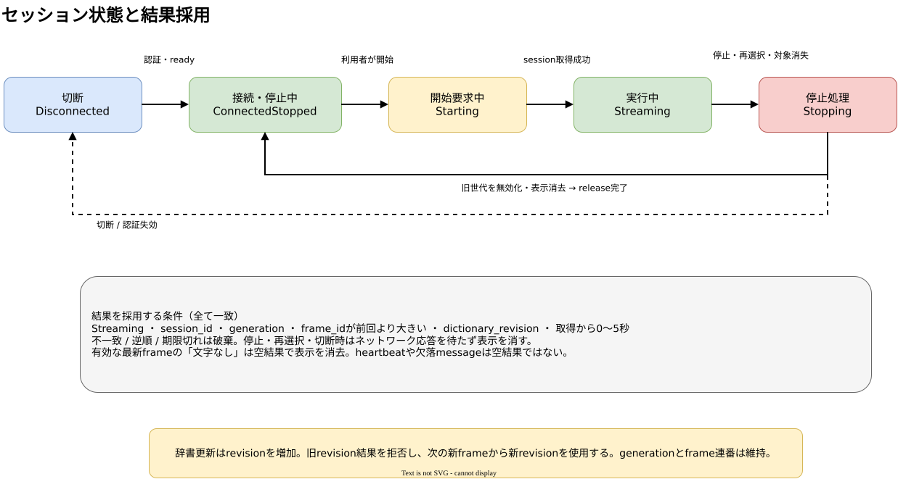

# セッション・世代・結果採用契約

## 文書情報

- 対象: v1.0 Windows client / Linux server のsession、frame、設定・辞書revision
- 状態: 採用
- Issue: [#63](https://github.com/kwdch013/screen_traslation/issues/63)
- 根拠: [基本・詳細設計](../docs/v1.0/design/architecture.md) の FLW-001～004 / DAT-001～004 / Session state machine、REQ-F-003 / 006 / 007 / 008 / 010、REQ-NF-001 / 004、ACC-02 / 04 / 08 / 09 / 11
- 座標契約: [coordinates.md](coordinates.md)

## 識別子と時計

| 項目 | 型・スコープ | 発行・更新規則 |
|---|---|---|
| `session_id` | UUID文字列 | サーバーが明示開始ごとに新規発行する。終了したIDは再利用しない。 |
| `generation` | 1以上の符号なし64-bit整数 | クライアントがsession内で開始時1から管理する。対象/ROI/DPI context変更、stop、対象消失、切断を検知した時点で直ちに増やし、旧値を無効にする。1session内で再利用しない。 |
| `frame_id` | 1以上の符号なし64-bit整数 | クライアントが `(session_id, generation)` ごとに1から採番し、送信順に厳密増加させる。新generationで1へ戻す。 |
| `dictionary_revision` | 1以上の符号なし64-bit整数 | サーバーが設定/辞書の確定revisionとして所有する。サーバーの初期有効値は1。 |
| `captured_monotonic_ns` | クライアント内の単調時計ナノ秒 | 画像取得時にクライアントだけで記録し、`(session_id, generation, frame_id)` に対応づける。別ホストへ送信したり、サーバー時刻と比較したりしない。 |

通信上のframe/resultには同じsession_id, generation, frame_id, dictionary_revisionを含める。取得時単調時計値はクライアントの相関台帳に置く。サーバーは自ホスト内で測ったOCR/翻訳処理時間を`server_processing_ms`として返せるが、クライアントの表示期限計算に使わない。

サーバーはsessionごとに処理中frameを最大1件保持し、待機frameは最新1件だけ保持する。処理中に新しいframeが届いた場合、前の待機frameを破棄して最新frameへ置き換える。処理完了後に破棄したframeの結果は生成・配信しない。

## クライアント状態

| 状態 | 意味 | 許可される動作 |
|---|---|---|
| `Disconnected` | 認証済みstreamなし、表示なし | 接続操作のみ。画像取得・送信をしない。 |
| `ConnectedStopped` | 接続/ready済みだがsession未実行 | 対象/ROIの選択、設定確認、明示的な開始。 |
| `Starting` | 利用者が開始しsession取得中 | 画像送信と結果表示は禁止。成功時のみ`Streaming`へ進む。 |
| `Streaming` | 現session/generationで画像処理中 | 設定fps以下で取得・送信し、契約検査を通った結果だけ表示する。 |
| `Stopping` | stopまたはinvalidating eventを受けた直後 | 最初に送信を止め、generationを無効化し、表示を消去する。その後にrelease/切断を試みる。旧結果は無条件に破棄。 |

開始は利用者の明示操作に限る。接続・再接続、ready復帰、対象再選択、辞書更新は暗黙の開始を起こさない。開始要求中の失敗は`ConnectedStopped`へ戻し、sessionを得ていれば冪等releaseする。サーバー所有中の別端末は409 `SESSION_IN_USE`を受け、所有権を奪取しない。

## 状態遷移と無効化

| 現状態 | イベント | 原子的な最初の処理 | 次状態・後続処理 |
|---|---|---|---|
| `Disconnected` | 接続成功・ready | 表示がないことを維持 | `ConnectedStopped`。自動開始しない。 |
| `ConnectedStopped` | 利用者が開始 | 新session要求を一度だけ送る | 成功で新session_id/generation=1を設定し`Streaming`。失敗は停止状態を維持。 |
| `Starting` | session取得拒否/timeout | 取得済みIDがあればrelease | `ConnectedStopped`。2台目拒否は409として表示。 |
| `Streaming` | 利用者がstop | 送信停止、generation無効化、現在表示を即時消去 | `Stopping`からrelease後`ConnectedStopped`。release失敗でもローカル停止は維持。 |
| `Streaming` | ROI/対象/DPI context変更・再選択 | 旧generationを無効化し、取得/送信停止、表示消去 | sessionをreleaseし`ConnectedStopped`。新ROI選択後も利用者が再度開始する。 |
| `Streaming` | 対象消失/最小化/取得拒否 | 旧generationを無効化、送信停止、表示消去 | releaseを行い`ConnectedStopped`。対象復帰だけでは再開しない。 |
| 任意の接続状態 | WSS切断/認証失効 | 旧session/generationを無効化、送信停止、表示を消去 | `Disconnected`。再接続後も利用者の明示開始が必要。 |
| `Streaming` | 辞書revision確定 | 新revisionを即時activeとし、旧revision結果の採用を禁止 | `Streaming`継続。次の新規frameから新revisionを付ける。generation/frame連番は維持。 |
| `Stopping` / 停止状態 | 旧結果・逆順結果の到着 | 結果を破棄し表示状態を変えない | 現状態を維持。 |

停止・再選択・対象消失・切断では、イベント処理の最初にローカル表示を消去する。要求する1秒以内の消去はネットワーク応答を待つ期限ではなく、client側の即時無効化が満たす。履歴はstop後に閲覧可能とするが、再選択、新session、アプリ終了で消去する。履歴上限は最新100件。

## 結果の採用判定

結果を表示・履歴へ反映するには以下をすべて満たす。どれか一つでも不一致なら破棄し、以前の表示を復活させない。

1. client状態が`Streaming`である。
2. resultの`session_id`と`generation`が現在値に一致する。
3. resultの`frame_id`が現在generationで採番済みであり、最後に採用したframe_idより大きい。
4. resultの`dictionary_revision`が現在有効revisionに一致する。
5. 対応する取得時刻がclientの相関台帳に存在し、現在の単調時計との差が0以上5秒以下である。
6. 領域座標が元画像サイズ内の半開区間である。

結果期限は取得からちょうど5秒まで有効、5秒を超えた時点で失効する。停止などで消去された結果は期限内でも採用しない。辞書更新前に取得・処理された旧revision結果も、更新後は採用しない。

有効な最新frameの処理完了が「文字なし」を示す場合は空のregion一覧と明示statusで返し、現在字幕を消去する。エラー・heartbeat・状態通知・欠落messageを空結果として扱わない。空結果もsession/generation/frame/revision/期限の検査を通す。

逆順に到着した結果は、既により大きいframe_idを適用済みなら破棄する。同一frame_idの重複結果も破棄する。frameが処理中/待機中にgenerationが変わった場合、serverは可能な範囲で処理をキャンセルし、完了しても結果を配信しない。クライアントの上記照合は最後の防御線として常に適用する。

## セッション所有権と切断

サーバーは同時に一つのsession ownerだけを保持する。明示stopではsessionを解放し、他端末の開始を許可する。無通信5秒以内に切断を検知し、検知後10秒以内に所有権を解放する。再接続したclientは旧sessionを復元せず、新しい明示開始を行う。通信遅延中に旧ownerが残っていれば409を返し、暗黙に交代しない。

## 設定・辞書更新

設定・辞書はサーバーがrevisionと永続化を所有する。更新要求は読込時のrevisionを条件にし、現在値と一致した更新だけを原子的に保存する。成功時はrevisionを1増やして返し、競合時は409を返す。409では他者の更新を上書きせず、再読込を促す。保存に失敗した場合、revision・有効値とも直前の確定版を維持する。

クライアントは保存成功応答を受け取った時点で新revisionをactiveにし、次に取得するframeから採番する。既存処理中frameには旧revisionを保持させるが、その結果は新revision適用後に表示しない。frame_idやgenerationをrevision変更だけを理由に戻さない。

[編集用draw.io](../docs/v1.0/design/diagrams/state-session.drawio)
