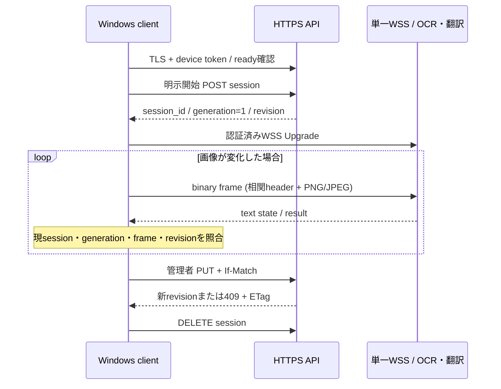

# v1.0 API詳細設計

## 文書情報

- 対象: v1.0 Windows client / Linux server間の制御・設定・翻訳結果API
- 状態: 採用
- 作成日: 2026-10-30
- Issue: [#62](https://github.com/kwdch013/screen_traslation/issues/62)
- 要件: REQ-F-003 / 004 / 006 / 008 / 009 / 010 / 011、REQ-NF-001 / 004 / 006 / 007
- 上位設計: [基本・詳細設計](architecture.md) API-001～008、FLW-001～004、DAT-001～007、[通信ADR](adr/0001-transport.md)、[TLS/資格情報ADR](adr/0004-tls-credentials.md)
- 契約正本: [OpenAPI](../../../contracts/openapi.yaml)、[共通契約README](../../../contracts/README.md)、[`schemas/`](../../../contracts/schemas/)
- 関連状態契約: Issue #63の[`coordinates.md`](../../../contracts/coordinates.md)・[`session-state.md`](../../../contracts/session-state.md)。座標系・generation/session/frame/revisionの採番と意味は#63を正本とする。
- 更新日: 2026-10-30

## 目的・責務・利用箇所

HTTPS APIは準備状態・session・設定・辞書・資格情報を制御します。単一WSSは画像binary messageを受け取り、処理状態・翻訳結果を双方向接続で返します。認証とTLSは全経路で必要です。既存Web版のAPIとは分離し、こちらをv1.0 Windows/Linux間通信の仕様とします。

### 使用する要件・操作

- Client: 接続/明示開始/停止、fps設定と辞書編集。画面取得・ROI・字幕表示・履歴はWindows側。
- HTTPS API入口: TLS、role、session所有権、サイズ/型を認証後に検査。
- WSS: 接続中の資格情報失効・所有権を再確認し、画像をOCR/翻訳portへ渡して結果を返す。
- Settings/Glossary store: Linux側でrevisionと原子的永続化を所有。

## 共通通信条件

| 条件 | 仕様 |
|---|---|
| HTTPS/WSS | TLS 1.2以上。平文fallbackなし。Clientは接続先から設定された信頼情報を検証 |
| API base | `/api/v1`; WSS route `/api/v1/stream` |
| 認証 | TLS確立後の`Authorization: Bearer`。端末tokenと管理tokenを分離しquery string禁止 |
| HTTP request body | 1 MiB以下。settings PUTは16 KiB以下、glossary PUTは1 MiB以下、credential発行は16 KiB以下 |
| HTTP error body | 4 KiB以下、`error.schema.json`の4 fieldのみ |
| WSS | 1本の双方向接続。subprotocol `screen-translation.v1`、Upgrade前に認証 |
| WSS state/result text | state 4 KiB以下、result 1 MiB以下 |
| WSS image binary | 1 message、画像payload 4 MiB以下。8-byte header + 4,096-byte metadata + 4 MiB画像payloadの合計で、message 4,198,408 bytes以下 |
| Retry | 認証・権限・形式・競合は自動再試行しない。503 `MODEL_NOT_READY`のみready再確認後に明示操作で再試行 |

認証失敗は401、role/所有者不一致は403。資格情報失効は新規HTTPS要求に即時適用し、既存WSSも最大1秒で送受信を拒否します。資格情報と画像・原文・訳文を永続ログ/応答へ記録しません。

## API一覧・入出力

OpenAPIはpath/method、schema、status、security schemeの機械可読な正本です。ここでは制御順序と失敗動作を定義します。

| ID | 操作 | 入力・権限 | 正常 | 主な異常 |
|---|---|---|---|---|
| API-001 | `GET /api/v1/health` | device/admin token | 200 `status=alive` | 401 |
| API-002 | `GET /api/v1/ready` | device/admin token | 200 `ready=true` | 401 / 503 `MODEL_NOT_READY` |
| API-003 | `POST /api/v1/sessions` | device token、空body | 201 `session_id`, `generation=1`, active `dictionary_revision` | 401 / 409 `SESSION_IN_USE` / 503 |
| API-004 | `DELETE /api/v1/sessions/{session_id}` | owner device token | 204。停止済みIDの再解放も冪等成功 | 401 / 403 / 404 |
| API-005 | `GET/PUT /api/v1/settings` | GET device/admin、PUT admin + If-Match | 200 schema+revision | 401 / 403 / 409 / 413 / 422 |
| API-006 | `GET/PUT /api/v1/glossary` | GET device/admin、PUT admin + If-Match | 200 entries+revision | 401 / 403 / 409 / 413 / 422 |
| API-007 | `GET /api/v1/stream` | device token、Upgrade | 101。binary imageとtext state/result | 400 / 401 / 403 / 409、close 1008/1009/1011 |
| API-008 | `POST /api/v1/admin/credentials` / `DELETE .../{credential_id}` | admin token | 201 one-time token / 204 revoked | 401 / 403 / 404 / 422 |

### 呼び出し順序

1. Clientは証明書検証を完了してhealth/readyを呼びます。ready false/503ならsession開始・frame送信をしません。
2. 利用者が開始した時だけsessionを作ります。2台目は409 `SESSION_IN_USE`となり、既存所有者を切断/上書きしません。
3. Clientは得たsession IDを使ってWSSを開きます。serverはUpgrade前と以降の各messageでtoken/sessionを検査します。
4. WSS binary frameを受信したserverは宣言値・実長・型/寸法・session/generation/frame/revisionを照合してからdecoderと処理へ進みます。
5. 結果は入力と同一相関値で返します。Clientは#63の採用条件と取得時単調時計の5秒期限を検査し、一項目でも不一致なら破棄します。
6. 停止/対象消失/再選択時、Clientが先に送信停止・generation無効化・表示消去し、DELETEでserverを解放します。WSS切断後も再接続だけでは再開しません。

## binary画像フレーム

WSS message layoutの正本は[契約README](../../../contracts/README.md#wss-binary-frameのwire形式)と`frame-metadata.schema.json`です。4 byte ASCII `STF1`、4 byte unsigned big-endian metadata byte長、UTF-8 JSON、画像bytesの順に1つのWebSocket binary messageを構成します。Metadataは最大4,096 bytes、image payloadは最大4,194,304 bytesです。実payload長は`image_length`と一致させます。

Metadata項目:

| field | 型 | 制約/発行元 |
|---|---|---|
| `contract_version` | integer | `1`固定 |
| `session_id` | UUID string | HTTPS開始応答のID |
| `generation` | uint64 | #63に従いclient管理。session内で再利用しない |
| `frame_id` | uint64 | #63に従い(session,generation)内で単調増加 |
| `dictionary_revision` | uint64 | server所有。GET/開始/成功更新で取得 |
| `image_width` / `image_height` | integer px | 64～1,920 / 32～1,080 |
| `content_type` | enum | `image/png`, `image/jpeg` |
| `image_length` | uint32相当 | 1～4,194,304、実byte数と一致 |

積`image_width × image_height`は2,073,600以下。serverは認証/所有権→header/受信長→JSON schema→実format/寸法/展開画素→相関/現revisionの順に検査します。宣言長の切詰め、画像縮小、偽装MIME許容はしません。失敗時はdecoderを呼ばず破棄します。

ROIの仮想screen physical px、負座標、画像座標原点・矩形半開区間は#63の[座標契約](../../../contracts/coordinates.md)を参照します。#62のschemaは座標/結果型の外形と範囲を持ちますが、座標変換や状態遷移を複製しません。

## WSS text state / result

serverからclientへのtext JSONは[`stream-message.schema.json`](../../../contracts/schemas/stream-message.schema.json)で`state`, `heartbeat`, `result`, `error`のいずれか一つに限定します。

- `state`: session/generation/frame/revisionとUUID `correlation_id`、`accepted | processing | ready | stopped`を示します。frame未割当の状態では`frame_id: null`です。エラーcloseを空結果に読み替えません。
- `heartbeat`: 1秒間隔の生存通知です。session/generation/frame/revisionとcorrelation IDを含み、未関連frameは`frame_id: null`です。
- `error`: 失敗したframeのsession/generation/frame/revisionと`code`, `correlation_id`を持ち、入力内容・例外詳細を返しません。
- `result`: session/generation/frame/revision、UUID correlation ID、status (`ok | empty`)、画像寸法、領域配列、`server_processing_ms`を含みます。
- 領域: `rect`は画像座標の`left, top, right, bottom`、または位置不明を表す`null`。英語原文`source`、日本語`translation`、0..1のconfidenceを含みます。
- `empty`は有効に処理したframeに文字が無かったことを意味し、`regions=[]`。status/event欠落やエラーはemptyではありません。
- Serverは処理中1件と待機最新1件を超えて蓄積しません。受信者ごとのevent queueは最大8件で、送信期限は1秒です。満杯なら最古eventを破棄し、期限超過の受信者は切断します。破棄したframeの結果は返しません。

`frame_id`はstate/heartbeatにも必須とし、frameに未関連なら`null`を送ります。これにより制御状態と画像処理状態を同じ形式で相関できます。全messageの`correlation_id`は、段階時間・破棄診断とclient/server間の追跡を本文を記録せず結び付けるため必須です。result/errorの`session_id`、`generation`、`frame_id`、`dictionary_revision`は、clientが所有session・現世代・送信frame・有効revisionを照合して古い結果を拒否するため必須です。これはstream-messageに対するwire上の破壊的変更であり、v1.0未リリースの間にclient/server双方を同時更新します。旧clientは未知の`heartbeat` typeを拒否するため、新serverと混在させません。互換性方針は[contracts README](../../../contracts/README.md#互換性と版管理)を参照してください。

相関値の発行者、generation/frame採番、辞書反映、逆順/旧世代結果の破棄、単調時計の5秒期限は[session state契約](../../../contracts/session-state.md)を正本とします。

## Settings / Glossary revision競合

- GET応答は`schema_version=1`, `revision`, 値を含みます。Revisionは1～2^64-1の正整数、初期値1。
- PUTは`If-Match: "<GET revision>"`と更新値を送ります。bodyにrevisionを重複させず、前提条件と更新payloadを分離します。
- Serverは認可→body/項目検証→If-Match比較→一時保存/fsync/atomic replace→revision加算→200応答の順で実施します。
- 現revisionと違えば409 `REVISION_CONFLICT`、bodyは未更新、`ETag: "<current revision>"`を返します。ClientはGETで再読込し、他者の値を上書きせず編集を再適用します。
- 永続化失敗は500 `INTERNAL_ERROR`、revision/active値とも直前確定状態を保ちます。別種の設定と辞書は個別にcommitします。
- 確定revisionは次の新規frameから用い、旧revision結果は表示しません。generation/frame連番をrevision更新だけで戻しません。

| 対象 | field制約 |
|---|---|
| settings `capture_fps` | integer 1～5、既定2 |
| glossary `entries` | 最大1,000件 |
| glossary `source` / `target` | 空不可、各最大128 Unicode文字 |
| result regions | 最大500件、原文/訳文各最大2,048 Unicode文字 |

件数/文字数超過は413 `PAYLOAD_TOO_LARGE`、値の意味・型不正は422 `INVALID_REQUEST`で、認証済み要求でも保存前に拒否します。

## 共通エラー・復旧

JSON errorは`code`, 利用者向け`message`, UUID `correlation_id`, boolean `retryable`だけを返します。stack trace、request path/body、token、画面内容を返しません。HTTP status/codeの全表と例は[contracts README](../../../contracts/README.md#共通エラー)・[`fixtures/errors.json`](../../../contracts/fixtures/errors.json)を参照。

| 状況 | HTTP/WS | 復旧動作 |
|---|---|---|
| malformed JSON / framing | 400 / close 1008 | client実装/契約版を確認、同一payload再送しない |
| unauthenticated / expired / revoked | 401 / close 1008 | 設定済み信頼先を確認し明示認証 |
| role / session owner mismatch | 403 / close 1008 | 所有を奪わない。正しい端末/管理tokenを使う |
| session already active | 409 | 現owner解放後、利用者が開始操作を再実行 |
| stale revision | 409 + ETag | GETし編集を再適用 |
| image/message over limit | 413 / close 1009 | ROI再選択か画像設定を見直す。無断縮小しない |
| invalid image/geometry | WSS `INVALID_IMAGE`, close 1008 | format, decoded dimensions, #63 coordinatesを確認 |
| model not ready | 503 | readinessを表示し、準備後に明示再試行 |
| processing fault | 500 / close 1011 | correlation_idで運用者が調査。内容をログに保存しない |

WSS close reasonは固定code `AUTHENTICATION_FAILED`, `SESSION_MISMATCH`, `PROTOCOL_VIOLATION`, `MESSAGE_TOO_LARGE`, `PROCESSING_FAILED`のいずれかで、最大123 UTF-8 bytes。秘密や入力値を含めません。クライアント向けcorrelation IDを必要とする入力エラーはUpgrade前HTTP error、Upgrade後は汎用`error` text message (`code`, `correlation_id`)後にcloseします。詳細close fixtureは#64の作業範囲です。

## テスト観点と未実証

| 観点 | 入力 | 期待 |
|---|---|---|
| auth/role | tokenなし・期限切れ・端末tokenで管理PUT | 401 / 403、WSSはUpgrade拒否 |
| session競合 | 2端末が同時開始 | 一方のみ201、他方409、暗黙奪取なし |
| HTTP境界 | JSON 1 MiBと+1、設定/辞書 field下限・上限・+1 | 境界許可、超過拒否、revision不変 |
| frame境界 | 64×32、1920×1080、payload 4 MiB、各+1/偽装 | 境界許可、超過・形式不一致をdecode前拒否 |
| revision | 同一ETagの2更新、古いETagの再送 | 一方のみ確定、409+current ETag、再読込案内 |
| result | empty、旧generation、逆順frame、旧revision | 有効emptyのみ字幕を消去、他は表示せず |
| protocol | STF1/length/JSON/payload truncation・trailing bytes | framing違反close、decode前拒否 |

契約fixtureの正本は[`contracts/fixtures/`](../../../contracts/fixtures/)です。Python 3.14の独立Draft 2020-12検証は`server/tests/contracts/`、同じ期待結論を読むC#の厳密検証は`client/tests/ScreenTranslation.Contracts.Tests/`で行います。実行はrootから`docker compose -f server/compose.test.yml run --build --rm test`と`docker compose -f client/compose.test.yml run --build --rm test`です。通常の`app:ci`は契約文書をコピーしないため、マウントなしの既存`src/tests`で契約テストをskipします。OpenAPIはRedocly CLI 1.34.5、Node 24.11.1でlintします。fixtureテストはschemaと計算例の一致を検査しますが、TLS、失効反映時間、実画像decoder、性能、実機座標の合格を示しません。後続#72/#74/#79/#89/#108/#109/#136がそれぞれ実装・実証します。
