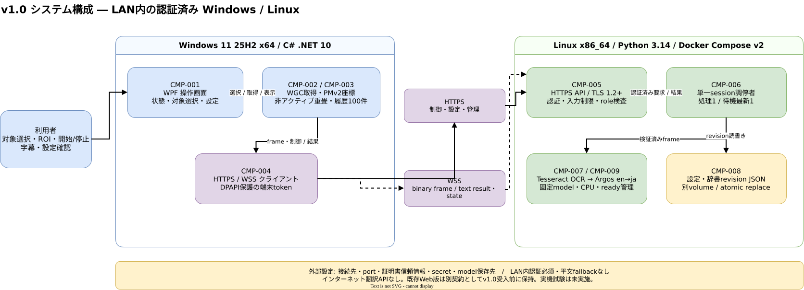
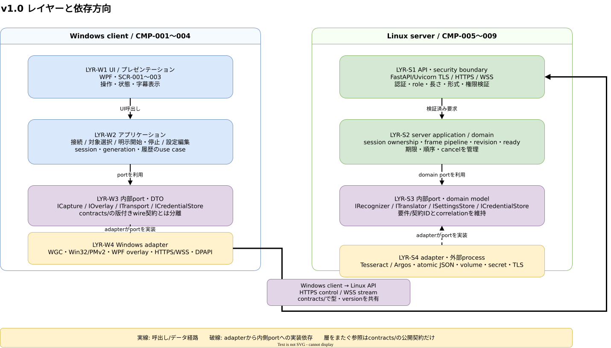

# v1.0 基本・詳細設計

## 文書情報

- 対象版: v1.0
- 状態: **設計採用**。要件はOwner承認済み。方式と境界を本書・ADRで採用した。Windows実機のAPI相互運用、製品性能、品質、独立/本人受入は未実施であり、採用方式の実証完了を意味しない。
- 作成元: Issue [#57](https://github.com/kwdch013/screen_traslation/issues/57)
- 根拠: [要件書](../../../requirements/version_1/requirements.md)、[受入計画](../acceptance.md)、[脅威モデル](security.md)、[技術選定ADR](adr/README.md)、[調査資料](../research/)
- 作成・更新日: 2026-10-30
- 改訂履歴: 2026-10-30 — #55/#56/#58/#59/#60を反映して方式・基本設計・主要な詳細動作・下流反映先を採用。実機未確認事項を分離。

## 前提/仮定

| ID | 前提または仮定 | 扱い・確認先 |
| --- | --- | --- |
| ASM-01 | Windows 11 25H2 Home/Pro x64、.NET 10 LTS安定SDK、Linux x86_64/Python 3.14、LAN内単一利用者を対象とする。 | Owner承認済み要件。Windows 10/ARM64/x86、一般公開、マルチユーザーは対象外。 |
| ASM-02 | C# UIはWPF、画面取得はWindows.Graphics.Capture (WGC)、自己ウィンドウの取得除外はWDA_EXCLUDEFROMCAPTURE、座標認識はPer-Monitor V2を採用する。 | #58/#59は資料調査とモデル検証まで。Windows APIの組合せ、フォーカス維持、自己取得除外、混在DPI/負座標の精度は未実施。#135と#136相当のWindows実機Taskで確認する。 |
| ASM-03 | 通信はアプリ内TLS終端のHTTPS制御/設定APIと、1本のWSS双方向ストリームを採用する。 | 通信統合の製品実証は未実施。Q-01を#62/#64/#74/#79/#89/#108で検証し、不成立時はADR更新と下流Issue再反映を行う。 |
| ASM-04 | UI/取得/座標/表示/履歴はWindows、認証/所有権/OCR/翻訳/設定永続化はLinuxが責任を持つ。 | 同一リポジトリの`client/`・`server/`・`contracts/`へ配置する。既存Web版・契約・起動手順はv1.0受入前に撤去しない。 |
| ASM-05 | Tesseract + Argos TranslateのCPU実行、モデルの明示導入、依存/モデルの固定を採用する。 | #60でPython 3.14の小規模互換性を実測。製品ready、性能、品質、信頼済みdigest/ライセンスは未実施で#77/#81/#109等で確認する。 |
| ASM-06 | 資格情報失効はHTTP/WSS操作・配信に1秒以内で反映する。TLS証明書の更新失敗時は旧設定を自動承認せず新規接続を停止する。 | 設計値。Q-07/Q-08、#74/#75/#108で期限境界と更新・復旧を測定する。合意済み要求を緩和しない。 |
| ASM-07 | 混在DPI/負座標の純粋な座標算術モデルは参考仕様とし、OS APIから得た値へ同じ倍率を二重適用しない。 | #63で契約を定義し、#136相当のWindows実機試験で取得画像・画面・重畳各隅の誤差を確認する。 |

## システム構成

システム境界はWindowsネイティブクライアント、LAN、Linuxコンテナで構成する。インターネットの翻訳APIや外部LLM/VLMは通常経路に含めない。接続先・ポート・証明書信頼情報・資格情報・モデル保存先は外部設定から与え、特定のマシン情報を既定値や文書へ固定しない。

[編集用draw.io](diagrams/system-architecture.drawio)

| ID | 要素 | 責務・境界 |
| --- | --- | --- |
| CMP-001 | WPF操作画面 | 接続状態、対象選択、開始/停止、fps、字幕履歴、辞書/翻訳設定を表示する。 |
| CMP-002 | Windows取得・座標 | WGCから選択対象を取得し、物理画素ROIを検証する。DPI/対象/サイズの変化で古い座標を破棄する。 |
| CMP-003 | 非アクティブ重畳・履歴 | 対象のフォーカスとクリックを妨げず結果を表示する。最新100件をメモリ保持する。 |
| CMP-004 | HTTPS/WSSクライアント | サーバー証明書と設定済み信頼情報を検証し、認証済み制御要求とフレーム/結果ストリームを運ぶ。 |
| CMP-005 | TLS・認証・API入口 | Linuxアプリ内でTLSを終端し、全経路の端末/管理権限、Host/Origin、長さ、形式を検査する。 |
| CMP-006 | セッション調停・処理制御 | 単一所有者/処理枠、最新待機1枚、世代/連番/revision、キャンセルと期限を管理する。 |
| CMP-007 | OCR/翻訳コア | Tesseractで英語OCR、Argosで英日翻訳し、辞書適用後の領域付き結果を返す。 |
| CMP-008 | 設定/辞書ストア | revision付き設定・辞書をデータvolumeへ原子的に保存し、資格情報と分離する。 |
| CMP-009 | モデル/準備管理 | 明示導入した版固定モデルを検証・warmupし、healthとreadyを分ける。 |

## 技術スタック

| 区分 | 採用方式 | 用途・制約 |
| --- | --- | --- |
| Windowsアプリ | C# / .NET 10 LTS / WPF / win-x64自己完結配布 | SDKは2026-10-30時点の安定版10.0.402、runtime patch 10.0.14を基準に`global.json`/lockへ固定し、更新時はサポート中パッチへ追従する。MicrosoftはLTSをサポート期間中の最新patchへ更新するよう求めている。 [公式サポート方針](https://dotnet.microsoft.com/en-us/platform/support/policy/dotnet-core) / [SDK配布](https://dotnet.microsoft.com/en-us/download/dotnet/10.0) |
| 画面取得 | Windows.Graphics.Capture | 利用者が選んだ画面/ウィンドウを取得する。取得対象消失/最小化/拒否時に安全停止する。WGCとWPF/Win32相互運用は実機で未確認。 |
| キャプチャ除外 | WDA_EXCLUDEFROMCAPTURE | 自アプリの重畳トップレベルHWNDへ設定する。DRM・全取得API/保護画面に対する保証ではない。除外を確認できない時はフレーム送信を止める。 |
| 座標 | Per-Monitor V2 + 物理画素の契約 | Windowsの仮想化値を無条件に物理pxとみなさない。#63が契約式/境界矩形を確定し、#136がOS上の値を実測する。 |
| 通信 | HTTPS + WSS、TLS 1.2以上 | アプリ内TLS終端。証明書検証無効化、平文へのfallback、secretのquery格納を禁止。WSS接続は開始前に端末認証する。 |
| Linuxサービス | Python 3.14 / Linux x86_64 / Docker Compose v2 | CPU 2以下、メモリ4 GiB以下。TesseractとCPU向けArgos依存を固定し、モデルを永続volumeへ明示導入する。 |
| 保存 | 設定/辞書の原子的JSONファイル + revision | SQLite等の追加DBは導入しない。資格情報/秘密鍵、画像/原文/訳文とは保存場所を分ける。revision競合と復旧は#83～#85で試験する。 |
| テスト | Python文書/サーバー試験はPython 3.14コンテナ、Windows APIはWindows実機 | LinuxテストでWindows取得/DPI/重畳の実機合格を代替しない。 |

SDKパッチは現在の公式配布情報を作成日に確認した値である。CI設定時点にも安定版を再確認し、プレビューは使わない。WPF/取得/配布を同じWindows実機Taskで評価する。CPU Torchを含む固定依存は#60の調査結果に従い、標準PyPI解決に任せない。

## 画面

| 画面ID | 画面・権限 | 主な操作/表示 | 状態と遷移 |
| --- | --- | --- | --- |
| SCR-001 | 接続・翻訳 (端末資格情報) | 接続設定、状態/復旧理由、対象選択、ROI選択、開始/停止、fps(1～5、既定2)、字幕重畳と履歴最大100件。 | 未接続→認証中→接続/準備中→待機→実行中。認証/証明書/ready/使用中/対象失敗は具体的状態で表示。切断後は表示消去して待機へ戻り、自動送信しない。 |
| SCR-002 | 設定/用語辞書 (管理資格情報) | 英日モデル状態、翻訳設定、用語対、revision、保存/競合表示。秘密情報は表示しない。 | 読込→編集中→保存中→保存済み、またはrevision競合/入力エラー。競合時は他者値を上書きせず再読込を提示する。 |
| SCR-003 | サーバー管理 (管理資格情報) | health/ready、モデル準備、端末資格情報の発行/失効、証明書とバックアップの運用案内。 | 端末資格情報からは画面自体を表示/操作できない。発行時の平文secretは一度だけ管理者へ提示し再取得できない。 |

操作の見た目、キーボード操作、重畳位置はWindows上でACC-06/07/15に従って確認する。WPF採用がアクセシビリティ受入を保証するものではない。

## レイヤー

[編集用draw.io](diagrams/layers.drawio)

| 層ID | 層 | 主な要素 | 依存方向 |
| --- | --- | --- | --- |
| LYR-001 | UI・プレゼンテーション | SCR-001～003、状態/履歴/エラー表示 | UIアプリケーション層のみを呼ぶ。 |
| LYR-002 | Windowsアプリケーション | 接続/対象選択/開始停止/設定編集のuse case | 取得・座標・通信・履歴・重畳のportへ依存する。 |
| LYR-003 | Windowsアダプター | WPF、WGC/Win32、DPI、HTTPS/WSS、DPAPI | `contracts/`の外部契約へ依存し、画面状態を業務コアへ混ぜない。 |
| LYR-004 | サーバーAPI/セキュリティ境界 | HTTPS routes、WSS認証/受信制限、管理権限 | セッション/ドメインサービスへ検証済み入力を渡す。 |
| LYR-005 | サーバーアプリケーション/ドメイン | セッション調停、frame pipeline、設定/revision、ready | 内部コアとportへ依存する。ネットワーク/ファイルI/Oを直接持たない。 |
| LYR-006 | サーバーアダプター/外部プロセス | Tesseract、Argos、JSONストア、TLS、secret/volume | domain portを実装し、実行時間/資源/失敗を制御する。 |

## 業務フロー

### FLW-001 接続と明示開始

1. SCR-001は外部設定のURL/ポート/信頼情報を読み、TLS証明書の名前・期限・信頼を検証する。失敗時はsecret/画面画像を送らない。
2. 端末tokenをDPAPI CurrentUserから読み、HTTPSで認証付きhealth/readyを確認する。端末tokenはHTTPS/WSS Authorization headerだけで渡し、URL/query/logへ入れない。
3. 利用者の対象/ROI選択を受け、物理ROI制約を検査してから「開始」を受け付ける。接続/再接続だけではsessionを開始しない。
4. POST `/api/v1/sessions`でセッションを原子的に取得する。既存所有者がいれば409 `SESSION_IN_USE`として拒否し、奪取しない。
5. WSS `/api/v1/stream`を認証して確立する。制御APIとWSSの本人/所有権が一致しない場合は閉じる。

### FLW-002 画像から字幕表示

1. WGC取得ごとに対象handle、ROI、モニターID/DPI context、session/generationを照合する。対象/DPI/位置/サイズ変化は旧generationを無効にする。
2. 同一画素の画像を再送せず、既定2 fps・設定1～5 fps・最大5 fpsで変化フレームのみ送る。連続10秒の取得回数は設定値×10以下、無変化10秒は画像送信0件。
3. WSS binary messageでUTF-8 JSONメタデータとPNG/JPEG bytesを1メッセージに含める。メタデータは契約version、session_id、generation、frame_id、dictionary_revision、幅/高さ、content_typeを持つ。コード化/順序の正本は`contracts/`と#62/#63。
4. サーバーは認証/権限、実受信サイズ4 MiB、形式、幅64～1920/高さ32～1080/総画素数2,073,600以下、展開後サイズの順に検証する。境界超過/偽装/破損/古いrevisionは拒否し、画像を切り詰めたり無断縮小したりしない。
5. session単位で処理中1件、待機最新1件とし、新着時は古い待機画像を破棄する。Tesseract OCR→英日辞書適用/Argos翻訳→領域結果を行い、時間超過/キャンセル/エンジン失敗は有界なエラー状態で返す。
6. WSS text resultは同じsession/generation/frame/revisionと、領域別のsource/translation/画像座標、状態、server_processing_msを持つ。サーバー時計とWindows単調時計を差し引かない。
7. Windowsは取得時刻を単調時計で記録し、現在のsession/generation/revisionと一致し、取得から5秒以内の結果だけ描画する。停止/切断/再選択/対象消失時は1秒以内に現在表示を消し、遅延応答で復活させない。

### FLW-003 停止、切断、再選択

- 明示停止はDELETE `/api/v1/sessions/{session_id}`を行い、client側の送信を直ちに停止、generationを進め、画面表示を消す。serverは処理結果を以降配信しない。
- 1秒間隔のheartbeat/pingを使い、無通信5秒以内に切断を検知する。切断検知後1秒以内にWindows表示を消し、server所有権を検知後10秒以内に解放する。
- 再接続後は状態を「接続済み/停止中」とし、session取得と明示開始操作を再度必要とする。古いsession/generation/frameの結果は拒否する。
- 対象消失、WGC終了、キャプチャ除外失敗、未知のDPI contextはfail-closedで送信停止し、対象を再選択させる。

### FLW-004 設定・辞書更新

1. GET `/api/v1/settings`と`/api/v1/glossary`で現revisionと値を読む。
2. PUT要求には読み込んだ`revision`をIf-Match相当のpreconditionとして含める。現在値が違えば409 `REVISION_CONFLICT`と最新revisionを返し、変更値を保存しない。
3. 入力制約を検証して一時ファイルへ書き、fsync後にatomic replaceする。設定と辞書を別revisionで更新し、片方の失敗で他方を部分更新しない。
4. 保存成功後に新規frameから新revisionを適用する。処理中/遅延中の旧revision結果は配信前・描画前に破棄する。Windows字幕履歴は保持し、revision混在を明示する。

## 通信・API詳細

TLSと端末認証は全APIで必須。管理操作は管理token必須。通信路を認証済みでもsession ownership/roleを毎操作で照合する。routeは本設計の採用インターフェースで、request/response schema・field length・error fixtureの規範定義は#62が`contracts/`へ作成する。

| API ID | メソッド/パス | 認証/権限 | 主要入力→出力/失敗 |
| --- | --- | --- | --- |
| API-001 | GET `/api/v1/health` | 端末token | プロセス生存を返す。model未準備を成功readyと混同しない。 |
| API-002 | GET `/api/v1/ready` | 端末token | readiness・model/runtime状態を返す。準備不可時503 `MODEL_NOT_READY`。 |
| API-003 | POST `/api/v1/sessions` | 端末token | 明示開始のみ。成功201でsession_id/generation、所有中409 `SESSION_IN_USE`、ready未達503。 |
| API-004 | DELETE `/api/v1/sessions/{session_id}` | 所有者token | 停止/解放を冪等に行う。異所有者403、未知IDは404。 |
| API-005 | GET/PUT `/api/v1/settings` | GET:端末、PUT:管理token | 設定とrevision。validate failure 422、競合409 `REVISION_CONFLICT`。 |
| API-006 | GET/PUT `/api/v1/glossary` | GET:端末、PUT:管理token | source/targetの語対、revision。語対上限超過413、検証失敗422、競合409。 |
| API-007 | WSS `/api/v1/stream` | handshake時端末token、以降も失効/所有権を検査 | binary frame→text state/result。認証前はupgrade拒否。サイズ超過1009相当でclose、protocol/session違反は理由コード付きclose。 |
| API-008 | POST `/api/v1/admin/credentials`、DELETE `/api/v1/admin/credentials/{id}` | 管理token | 端末資格情報を発行/失効。平文tokenは発行応答で一度だけ返し、照合にはsalt付きhashを保存。 |

JSONエラー共通形式は`code`、利用者向け`message`、`correlation_id`、`retryable`に限定し、stack trace、path、token、画面内容を返さない。要求/応答上限、辞書件数/文字長、状態コード、WSSメッセージframe layoutは#62でschemaとfixtureに固定する。#57では要件で決まっていない文字数等を根拠なく創作せず、#62へ設計決定を引き継ぐ。

## データと状態

### データ要素

| ID | データ | 主な項目・寿命 | 所有 |
| --- | --- | --- | --- |
| DAT-001 | Session | session_id、owner_credential_id、generation、開始/最終heartbeat。1アクティブ。切断検知後10秒以内に解放。 | Linux memory |
| DAT-002 | Frame | session_id、generation、frame_id、取得単調時刻(client local only)、dictionary_revision、画像bytes。処理1件+待機最新1件。処理後破棄。 | 両端memory |
| DAT-003 | TranslationResult | frame相関値、領域座標、原文、訳文、server_processing_ms。client表示は取得から5秒でexpire。 | 両端memory |
| DAT-004 | History | timestamp、領域、原文、訳文、状態。最新100件、停止中閲覧可。再選択/新session/終了で消去。 | Windows memory |
| DAT-005 | Settings | schema_version、revision、fps、OCR/translation options。原子的JSON保存。 | Linux data volume |
| DAT-006 | Glossary | schema_version、revision、source/target語対。資格情報から分離し原子的JSON保存。 | Linux data volume |
| DAT-007 | Credential | credential_id、salted verifier hash、role、expiry、revoked。平文の再取得不可。TLS private key/initial admin secretは別のsecret mount。 | Linux protected data/secret |
| DAT-008 | ModelManifest | model/version/source/size/SHA-256/license verification status。検証/warmup完了前はnot-ready。 | Linux model volume |

画像/原文/訳文/token/headerは永続ログへ書かない。運用ログに許可するのは相関ID、状態コード、件数、サイズ、処理時間、拒否理由の分類だけ。証明書/secret/設定実値は設定ファイル例やtask記録に残さない。

### Session state machine

サーバー所有状態は `Idle → Owned → Streaming → Stopping → Idle`。client表示状態とframe/generation/revisionの採否、辞書更新中の扱いは [`contracts/session-state.md`](../../../contracts/session-state.md) を正本とする。startは原子的で、Owned/Streaming中の別clientは409。Streaming中の停止、token revoke、heartbeat timeout、server shutdownは直ちにgenerationを無効化し、新結果配信を拒否する。heartbeat timeout時は5秒以内に検知し、検知から10秒以内にownerをfreeにする。明示停止ではownerを即時freeにする。

### Client result acceptance

座標変換と跨モニターROI方針は [`contracts/coordinates.md`](../../../contracts/coordinates.md)、結果採否とsession/generation/revision状態は [`contracts/session-state.md`](../../../contracts/session-state.md) を正本とする。stop/reselect/target-loss/disconnect時はgeneration無効化・表示消去を一連で行う。取得時刻はclient単調時計だけで測り、clientプロセス間/サーバーと比較しない。Windows実測での誤差2 physical px以下は #136 の受入条件である。

## セキュリティ、運用、復旧

[脅威モデル](security.md)と[ADR-0004](adr/0004-tls-credentials.md)を実装基準とする。TLS 1.2以上で信頼済み証明書のみ受理、HTTPS/WSS以外へfallbackしない。端末/管理tokenを分け、Windows保存はDPAPI CurrentUser、サーバーはsalt付きverifier hashを保存する。資格情報失効は新規要求・既存WS操作/配信へ1秒以内に反映する。

接続許可Hostと設定済みOriginをallowlist検証する。Originがないnative clientも認証必須。CSRF/CORS/Originを本人認証として扱わない。メッセージ毎に所有session/roleを検証し、画像は認証前に展開しない。入力長・画像・画素・処理時間・subprocess資源を制限する。文字列はHTML/markupやshellとして評価しない。

healthとreadyを分離する。healthはprocess liveness、readyはTesseract/Argos/モデルdigest/CPU版依存とwarmup成功を示す。model導入は管理者の明示操作とし、固定manifest照合・サイズ/ハッシュ/ライセンス確認・展開先検証・warmupの全てが成功してからreadyにする。導入済み起動→ready120秒、空のmodel領域から取得/検証/warmup→ready1800秒を受入閾値とする。超過/欠落/破損はnot-readyのまま具体的な復旧案内を出す。

設定/辞書は資格情報/モデルと分けたvolumeへ保存し、検証・revision照合後にbackup/restoreする。atomic replace途中で失敗した場合は最後の有効ファイルを保持する。構成情報と持ち出すbackupにはtoken hash、秘密鍵、画面内容を含めない。復旧後はrevoked tokenを復活させない。障害時の無制限再試行は禁止する。

## 詳細テスト観点

要件・受入条件の正本は[ACC-01～ACC-15](../acceptance.md)。設計テストは次を個別に記録する。

| Test ID | 入力/条件 | 期待結果 | 主な受入 |
| --- | --- | --- | --- |
| TST-001 | TLS valid / expired / SAN mismatch / unknown CA | validのみ認証へ進み、失敗はsecret/画像送信なし | ACC-05 |
| TST-002 | 不正/失効token、管理APIを端末roleで実行 | 401/403、既存WSSも1秒以内に操作/結果拒否 | ACC-05/12 |
| TST-003 | 同時に2台がsession start | 1台のみ201、他方は409。暗黙奪取なし | ACC-08 |
| TST-004 | 64×32、1920×1080、4 MiBと各+1、偽装/破損画像 | 境界は処理、+1/偽装は展開/OCR前に拒否 | ACC-11 |
| TST-005 | 処理中1、待機最新1に連続画像 | 古い待機を破棄し、最新結果だけ有効 | ACC-11/13 |
| TST-006 | stop/reselect/reconnect/dictionary update後に遅延/逆順応答 | 旧session/generation/frame/revisionを破棄し、表示1秒以内消去/5秒expire | ACC-02/04/09 |
| TST-007 | 100%/150%/200%、負座標、DPI境界移動、サイズ変更 | 対象と取得/表示各四隅誤差2 physical px以下。#136 Windows実機で測定 | ACC-06/07 |
| TST-008 | overlay表示、WGC対象変更、capture exclusion失敗 | 対象focus/click継続、自己画像混入なし。未確認ならfail-closed | ACC-03/07 |
| TST-009 | 同じ設定revisionと古いrevisionの更新 | 新revisionのみatomic保存、古い更新は409、部分書込みなし | ACC-09/14 |
| TST-010 | token revoke、server kill、network silence、resume | 失効反映1秒、切断検知5秒、owner release10秒、resumeで送信再開しない | ACC-04/05/08 |
| TST-011 | model欠落/破損、CPU wheel違い、warmup失敗 | ready=false、翻訳受理せず復旧理由を表示 | ACC-10 |
| TST-012 | 通常/例外/拒否経路で架空の文字列とsecretを流す | file/log/dump以外の出力に内容/secretが存在しない | ACC-12 |

Linux/C#契約fixtureは#64で自動化し、OS依存APIは#135/#136相当のWindows実機Taskで確認する。ACC-13測定と品質合否は#109、シナリオ/本人見た目確認は#110、これらの未実施/skipを設計採用の完了とみなさない。

## 図

基本設計ではシステム境界と依存方向をdraw.ioで示す。状態/座標/メッセージ契約の詳細図は#63が同じディレクトリの`state-session.drawio/.svg`、`coordinates-roi.drawio/.svg`として追加する。#63がこのTaskと図ファイルを共有するため、native dependencyが解除されるまで図を並行更新しない。

draw.io CLIでXMLを開き、同じ原本からSVGを出力した。出力SVGをPNGへラスタライズして全体と文字が読める倍率で確認し、重複ラベル、文字切れ、文字と線の重なり、不要な二重線がないことを確認する。描画・出力・表示確認のコマンドと結果はPR記録へ残す。

## 下流Issueへの仕様反映

以下は設計採用を下流へ伝える反映先と、Issue本文へ転記する具体値/方式の一覧である。未実装・未検証のIssueを完了扱いにせず、native dependencyや`issue/block`は各Task完了・ゲートに従って維持する。Issue本文を変える場合は既存本文を保存し、差分確認、本文全体の再取得を行ってからLabelを遷移する。ここにない #61～#111 は親Phaseの要件ID表と本表の該当行を参照し、仕様の分岐/テスト完了条件を追加しない。

| Issue | 設計反映内容 |
| --- | --- |
| #61 | 全22要件IDを下記対応表に結び、`contracts/`のfixture・互換性を#62～#64で扱う。 設計参照: `docs/v1.0/design/architecture.md#下流issueへの仕様反映` |
| #62 | HTTPS制御/設定 + 1本のWSS。binaryフレームにsession/generation/frame/revision、幅/高さ/content_typeを含め、同一メッセージ内にPNG/JPEG bytes。HTTPは4 MiB画像境界、ROI64×32～1920×1080・2,073,600画素、+1/偽装拒否。詳細schema/field長/error fixtureを契約正本にする。 設計参照: `docs/v1.0/design/architecture.md#下流issueへの仕様反映` |
| #63 | 画像座標は物理ROI左上原点・半開区間。モニター別DPI contextで変換し負座標を保持。ROIは一つのモニターへ完全包含のみ許可し、境界跨ぎ/隙間/画面外は開始前に拒否。session/generation/frame/revision・client内取得単調時刻を照合し、旧・逆順・期限切れ結果を破棄。JSON geometry fixtureをPython算術モデルで検証。Windows誤差2px以下は#136で実測。設計参照: `docs/v1.0/design/architecture.md`、[`contracts/coordinates.md`](../../../contracts/coordinates.md)、[`contracts/session-state.md`](../../../contracts/session-state.md) |
| #64 | HTTP/WSS双方で同じsession所有権/roleを検証。frameとresultの相関、旧世代/逆順/revision不一致拒否。request/response fieldとstatus/close codeをfixture化。 設計参照: `docs/v1.0/design/architecture.md#下流issueへの仕様反映` |
| #68 | .NET10 LTSの2026-10-30基準SDK 10.0.402とruntime 10.0.14、stable-only、global.json固定。client/server/contractsを同一repo内で分離し、Web版は受入前に保持。 設計参照: `docs/v1.0/design/architecture.md#下流issueへの仕様反映` |
| #69 | Python3.14 CPU Torchを明示したlock、Linux client-independent server、既存Web試験と新契約試験の別jobを維持する。 設計参照: `docs/v1.0/design/architecture.md#下流issueへの仕様反映` |
| #72 | 全HTTPS/WSSをTLS1.2以上+端末認証。偽/期限切れ/未信頼証明書、失効token、Host/Origin不許可を拒否。画像認証/受信長検証前のdecode禁止。 設計参照: `docs/v1.0/design/architecture.md#下流issueへの仕様反映` |
| #73 | 単一所有session、2台目409拒否、明示停止で解放、切断検知5秒以内/解放10秒以内。復帰だけではstartしない。 設計参照: `docs/v1.0/design/architecture.md#下流issueへの仕様反映` |
| #74 | Windows/サーバーのTLS、credential revoke反映1秒、WS切断5秒、owner解放10秒、旧generation/結果廃棄をコンテナ統合fixtureで検証する。 設計参照: `docs/v1.0/design/architecture.md#下流issueへの仕様反映` |
| #75 | 端末tokenと管理tokenを分離。256-bit CSPRNG、salt付きverifier hash、Windows DPAPI CurrentUser。既存WSにも失効1秒以内反映。初回管理secret/証明書rotationは失敗時secure stop。 設計参照: `docs/v1.0/design/architecture.md#下流issueへの仕様反映` |
| #77 | OCR/翻訳コアは副作用をadapterへ隔離して段階抽出。Tesseract英語 + Argos en→ja、CPU-only lock。Web経路/`#26`/任意LLM評価`#49`を変更しない。 設計参照: `docs/v1.0/design/architecture.md#下流issueへの仕様反映` |
| #78 | serverは処理中1/待機最新1。画像は設定1～5fps、default2、max5・取得以下、静止10秒送信0。中断不能なOCRも結果を配信/表示しない。 設計参照: `docs/v1.0/design/architecture.md#下流issueへの仕様反映` |
| #79 | 結果にsession/generation/frame/revision、region/source/translation/status/server_processing_msを含める。サーバー時刻とclient単調時計を混ぜず、旧結果を破棄する。 設計参照: `docs/v1.0/design/architecture.md#下流issueへの仕様反映` |
| #80 | engine結合はCPU 2/4 GiB、4 MiB/2,073,600画素境界、処理1/待機1、失敗時ready/結果が安全側に落ちること。性能/品質の合否は#109で別測定。 設計参照: `docs/v1.0/design/architecture.md#下流issueへの仕様反映` |
| #81 | livenessとreadinessを分離。導入済みready120秒、empty model領域から取得/検証/warmup ready1800秒。SHA-256/版/digest/CPU依存確認前はnot-ready。 設計参照: `docs/v1.0/design/architecture.md#下流issueへの仕様反映` |
| #82 | 設定/辞書/モデル/credentialを別ストア/volumeへ分離。revision conflictは409、原子的保存、バックアップ復元でrevoked token復活なし。 設計参照: `docs/v1.0/design/architecture.md#下流issueへの仕様反映` |
| #83 | 設定・辞書はschema_version/revisionを持つJSON。If-Match相当のrevision precondition、古いrevisionは409、atomic replace。 設計参照: `docs/v1.0/design/architecture.md#下流issueへの仕様反映` |
| #84 | GETは端末token、設定/辞書PUTは管理token。新revisionは次の新frameで有効、保存前frameの旧revision結果は破棄。 設計参照: `docs/v1.0/design/architecture.md#下流issueへの仕様反映` |
| #85 | 設定更新失敗/途中停止/再起動で最後の有効JSONを保持。healthは生存のみ、readyはmodel検証とwarmup完了時だけtrue。 設計参照: `docs/v1.0/design/architecture.md#下流issueへの仕様反映` |
| #88 | HTTPS/WSSのserver trustを検証してからtokenを送信。端末tokenをDPAPI CurrentUserで保存、secret/接続先は外部設定、平文/URL/logへ出さない。 設計参照: `docs/v1.0/design/architecture.md#下流issueへの仕様反映` |
| #89 | 1本のWSSをbinary frame + text status/resultに使用。disconnect時5秒以内検出、表示1秒以内消去、再接続後は明示start。 設計参照: `docs/v1.0/design/architecture.md#下流issueへの仕様反映` |
| #90 | WPF上のTLS失敗、session in-use 409、WSS断、ready false、再接続停止状態を表示するWindows結合観点。UI実機/自動化結果を記録。 設計参照: `docs/v1.0/design/architecture.md#下流issueへの仕様反映` |
| #92 | WGCの対象選択/終了/最小化を扱い、対象消失で停止。取得は設定1～5fps/既定2、変化frameのみ、ROI物理pxで制限する。 設計参照: `docs/v1.0/design/architecture.md#下流issueへの仕様反映` |
| #93 | ROI画像物理pixelを基準に64×32～1920×1080/最大2,073,600 px。Per-Monitor V2、負座標、DPI changeで変換context/generationを更新。 設計参照: `docs/v1.0/design/architecture.md#下流issueへの仕様反映` |
| #94 | PNG/JPEG encoded max4 MiB、変化時のみ、連続10秒 fps×10以内、設定fps以下。送信待ちを蓄積せずlatest frame優先。 設計参照: `docs/v1.0/design/architecture.md#下流issueへの仕様反映` |
| #95 | source/overlay capture exclusion失敗時は送信停止。frame metadataと画像ROIの一致、旧generationの拒否を実機で確認する。 設計参照: `docs/v1.0/design/architecture.md#下流issueへの仕様反映` |
| #97 | 別トップレベルWPF overlayを非アクティブ/クリック透過にする。WDA_EXCLUDEFROMCAPTURE/WGC実機が確認できない時はfail-closed。 設計参照: `docs/v1.0/design/architecture.md#下流issueへの仕様反映` |
| #98 | 取得から5秒で字幕expire、stop/reselect/target loss/disconnectから1秒以内消去。履歴は最新100件/stop後閲覧可、reselect/new session/終了で消去。 設計参照: `docs/v1.0/design/architecture.md#下流issueへの仕様反映` |
| #99 | 管理roleで設定/辞書編集。revision conflict 409を他者値で上書きせず表示し、成功revisionは新しいframeにだけ適用。 設計参照: `docs/v1.0/design/architecture.md#下流issueへの仕様反映` |
| #100 | SCR-001～003と明示開始、停止、対象再選択、失効、100件履歴、revision変更をend-to-endで確認する。 設計参照: `docs/v1.0/design/architecture.md#下流issueへの仕様反映` |
| #103 | Python3.14/Linux x86_64。server container 2 CPU/4 GiB以下。TLS private key/initial admin secretをread-only secret、設定/辞書/モデルを別volumeへ分離。 設計参照: `docs/v1.0/design/architecture.md#下流issueへの仕様反映` |
| #104 | WPF win-x64自己完結配布、SDKなし起動。自己署名コード署名試験は隔離環境のみで公開発行元信頼と区別する。 設計参照: `docs/v1.0/design/architecture.md#下流issueへの仕様反映` |
| #105 | TLS/credential/model provisioning、更新・失効、volume backup/restore、復旧後の明示再接続を文書化。端末固有情報/secretは載せない。 設計参照: `docs/v1.0/design/architecture.md#下流issueへの仕様反映` |
| #106 | 新規導入/更新/復旧後、health/ready、revision、失効、model digest、旧Web回帰を別々に確認する。 設計参照: `docs/v1.0/design/architecture.md#下流issueへの仕様反映` |
| #108 | Windows/Linux E2EでHTTPS/WSS・TLS不正・timeout5/1/10秒、session2台拒否、旧結果破棄、実画面とWGCを検証する。 設計参照: `docs/v1.0/design/architecture.md#下流issueへの仕様反映` |
| #109 | warm p50≤2000ms/p95≤4000ms、5秒expire、OCR/翻訳品質、CPU2/4GiB、8時間継続をOwner承認条件そのままで測定。 設計参照: `docs/v1.0/design/architecture.md#下流issueへの仕様反映` |
| #110 | ACC-01～15シナリオとユーザー見た目/操作感を確認。Windows実機のDPI/captureは#135/#136、skipを合格にしない。 設計参照: `docs/v1.0/design/architecture.md#下流issueへの仕様反映` |
| #111 | 全Task/phase、レビュー、実測、ユーザー受入が完了した後だけrelease成果/運用を確定。 設計参照: `docs/v1.0/design/architecture.md#下流issueへの仕様反映` |
| #135 | WGC/WDA_EXCLUDEFROMCAPTUREとDXGI/GDI比較、対象取得/自己混入/安全停止をWindows実機で測定し、ADR-0002/Q-02へ実績反映。設計や実装の前提に測定済みと記さない。 設計参照: `docs/v1.0/design/architecture.md#下流issueへの仕様反映` |
| #136 | Windows 11 x64、2画面以上、100/150/200%と負座標、移動/resizeのROI四隅物理px誤差≤2、DPI通知、focus/overlayを実測。ACC-06/07を個別判定しADR-0002/Q-03と契約へ結果共有。 設計参照: `docs/v1.0/design/architecture.md#下流issueへの仕様反映` |

### 要件IDと設計要素

| 要件ID | 基本設計要素 | 詳細設計/検証参照 |
| --- | --- | --- |
| REQ-F-001 | CMP-001/CMP-002 | SCR-001、FLW-001、API-003、ACC-01/03 |
| REQ-F-002 | CMP-002 | LYR-003、API-007、[#63](../../../contracts/coordinates.md)、TST-007、ACC-06 |
| REQ-F-003 | CMP-004/CMP-006 | FLW-002、API-007、DAT-002、ADR-0001/0005、ACC-01/11 |
| REQ-F-004 | CMP-007 | FLW-002、DAT-008、ADR-0006、ACC-01/10 |
| REQ-F-005 | CMP-002/CMP-003 | SCR-001、TST-008、ADR-0002、ACC-07 |
| REQ-F-006 | CMP-003/CMP-006 | FLW-003、[session-state.md](../../../contracts/session-state.md)、ACC-02/03 |
| REQ-F-007 | CMP-003 | DAT-004、SCR-001、ACC-02/12 |
| REQ-F-008 | CMP-008 | FLW-004、API-005/006、DAT-005/006、[revision採否契約](../../../contracts/session-state.md)、ACC-09 |
| REQ-F-009 | CMP-001/CMP-004 | SCR-001、FLW-003、API-002/007、ACC-04/05 |
| REQ-F-010 | CMP-005/CMP-006 | FLW-001/003、DAT-001、[session-state.md](../../../contracts/session-state.md)、TST-003/010、ACC-08 |
| REQ-F-011 | CMP-009 | API-002、model ready、TST-011、ACC-10 |
| REQ-F-012 | CMP-008/CMP-009 | deployment/restore, DAT-005～008、ACC-14 |
| REQ-NF-001 | CMP-005/CMP-006 | FLW-002、[frame/result採否契約](../../../contracts/session-state.md)、TST-004/005、ADR-0005、ACC-11 |
| REQ-NF-002 | CMP-007/CMP-009 | model ready/FLW-002、#109、ACC-10/13 |
| REQ-NF-003 | CMP-007/CMP-008 | FLW-004、#109、ACC-09/13 |
| REQ-NF-004 | CMP-003/CMP-006 | FLW-003/[result acceptance](../../../contracts/session-state.md)、TST-006、ACC-02/04 |
| REQ-NF-005 | CMP-006/CMP-009 | resource/timeout limits、#109、ACC-11/13 |
| REQ-NF-006 | CMP-005 | TLS/token/role checks、TST-001/002/010、ACC-05 |
| REQ-NF-007 | CMP-003/CMP-005/CMP-008 | DAT-003/004/007、logs/backups、TST-012、ACC-12 |
| REQ-NF-008 | CMP-001/CMP-002/CMP-003 | SCR-001～003、LYR-003、[座標契約](../../../contracts/coordinates.md)、TST-007/008、ACC-06/07/15 |
| REQ-NF-009 | CMP-004/CMP-005 | external settings and fail-closed behavior, TST-001, ACC-05/14 |
| REQ-NF-010 | CMP-001～009 | old/new isolation, docs/independent review/acceptance, ACC-14/15 |

## 未確定事項とOwner判断

以下は要件を勝手に変更せず、担当Taskが実測/契約化しIssueへ反映する。Windows実機の利用可能時期は本設計の開始を止めない。

- WGC/WDA_EXCLUDEFROMCAPTUREの対象ごとの実機挙動と安全側の可用性: #135。
- Per-Monitor V2とWPF/WGCの混在DPI、負座標、跨モニターROIポリシー、重畳位置誤差: #136と契約Task #63。
- HTTP/WSSの実装ライブラリで認証前Upgrade拒否、最大message/close、heartbeat上限を実現する設定: #62/#74/#79/#89。
- Argos/Tesseractの固定依存/モデル版、trusted digest、再配布条件と性能: #60/#77/#81/#109。
- .NET SDKパッチのCI固定時確認、WPF self-contained署名/更新方針: #68/#104/#106。
- `contracts/`における厳密なJSON schema、WSS frame layout、管理/端末role権限行列、文字列長/件数など上限: #62/#63/#64/#75。要件に数値がある上限は上記Issue反映表どおり変更しない。
- 要件値が実測で不達の場合、要件ID、計測条件/値、原因、推奨代替と不利益をOwnerへ示し、承認前に閾値や対象環境を緩めない。
